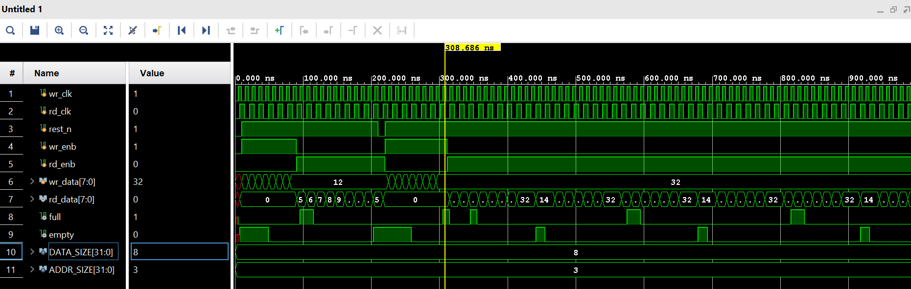

# Asynchronous FIFO

## Project Architecture
This project implements an 8-bit-wide asynchronous FIFO with a depth of 8 entries. The write and read interfaces use separate clocks, `wr_clk` and `rd_clk`. Binary pointers address the memory; Gray-coded pointers cross clock domains through two-flop synchronizers. The synchronized pointers are used to generate the `full` and `empty` status flags.

The flow through the design is:
1. The write side accepts data while `wr_enb` is high and `full` is low.
2. The read side returns data while `rd_enb` is high and `empty` is low.
3. Each side advances its own pointer only when its operation is accepted.
4. Gray pointers pass through synchronizers before the opposite clock domain uses them for status detection.

## Block Summary

| Module | Responsibility | Clock domain | Key outputs |
|---|---|---|---|
| [`async_fifo_top`](async_fifo_top.v) | Connects memory, pointers, synchronizers, and status logic | Both | `rd_data`, `full`, `empty` |
| [`FIFO_memory`](async_fifo_top.v) | Stores FIFO words and supplies read data | Write and read | `rd_data` |
| [`gray_converter_full`](async_fifo_top.v) | Advances the write pointer and generates its Gray code | Write | `b_wr_ptr`, `gr_wr_ptr` |
| [`gray_converter_empty`](async_fifo_top.v) | Advances the read pointer and generates its Gray code | Read | `b_rd_ptr`, `gr_rd_ptr` |
| [`ff_sync`](async_fifo_top.v) | Synchronizes a Gray pointer into the receiving clock domain | Destination clock | `q2` |
| [`empty_checker`](async_fifo_top.v) | Detects when read and synchronized write pointers match | Read | `empty` |
| [`full_checker`](async_fifo_top.v) | Detects the full pointer relationship | Write | `full` |
| [`async_fifo_top_tb`](async_fifo_top_tb.v) | Drives clocks, reset, and FIFO traffic for simulation | Both | Observed FIFO outputs |

## RTL Module Guide

### 1. `async_fifo_top` - System Integration
The top-level module connects the memory, read/write pointer generators, pointer synchronizers, and full/empty checkers. Its external interface provides both clocks, reset, enables, data input/output, and status flags.

### 2. `FIFO_memory` - Data Storage
The memory contains `2 ** ADDR_SIZE` words, each `DATA_SIZE` bits wide. It writes on `wr_clk` when a write is enabled and the FIFO is not full. It registers read data on `rd_clk` when a read is enabled and the FIFO is not empty. The memory contents are not reset; the output register is reset.

### 3. `gray_converter_full` - Write Pointer
This module keeps the binary write pointer and increments it only for an enabled write when the FIFO is not full. It also converts the next binary pointer to Gray code. The Gray pointer is sent to the read domain through `ff_sync`.

### 4. `gray_converter_empty` - Read Pointer
This module keeps the binary read pointer and increments it only for an enabled read when the FIFO is not empty. It generates the Gray-coded read pointer, which is synchronized into the write domain for full detection.

### 5. `ff_sync` - Clock-Domain Synchronizer
This parameterized two-stage register synchronizer transfers a Gray-coded pointer into the destination clock domain. The design instantiates it once for each pointer crossing: read pointer to write clock, and write pointer to read clock. Synchronization reduces metastability risk; it does not eliminate it.

The second view shows the other pointer-synchronizer instance:

### 6. `empty_checker` - Empty Flag
Clocked by `rd_clk`, this module sets `empty` during reset and otherwise compares the local Gray read pointer with the synchronized Gray write pointer. Equal pointers mean there is no unread data.

### 7. `full_checker` - Full Flag
Clocked by `wr_clk`, this module compares the local Gray write pointer against the synchronized read pointer with the two most significant Gray bits inverted. That pointer relationship indicates the write pointer is one FIFO depth ahead, so the FIFO is full.

## Testbench
[`async_fifo_top_tb`](async_fifo_top_tb.v) is the simulation testbench. It generates a 10 ns write-clock period and a 14 ns read-clock period, applies reset, sends write data, then enables reads. The waveform image is included below. The testbench is a stimulus example; it does not contain automated data comparisons or pass/fail assertions.

## Important Signals

| Signal | Description |
|---|---|
| `wr_clk`, `rd_clk` | Independent write and read clocks |
| `rest_n` | Active-low reset used by the sequential logic |
| `wr_enb`, `rd_enb` | Request write or read operations |
| `wr_data`, `rd_data` | FIFO input and registered output data |
| `full` | Blocks writes when the FIFO cannot accept more data |
| `empty` | Blocks reads when the FIFO has no unread data |

## Source Files
- RTL implementation: [`async_fifo_top.v`](async_fifo_top.v)
- Simulation testbench: [`async_fifo_top_tb.v`](async_fifo_top_tb.v)

The RTL is kept in the source file rather than duplicated in this README, so the module descriptions and schematics remain easy to scan.
